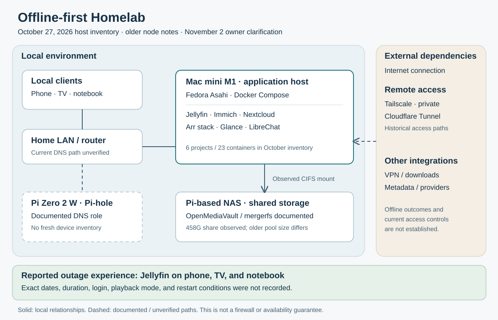
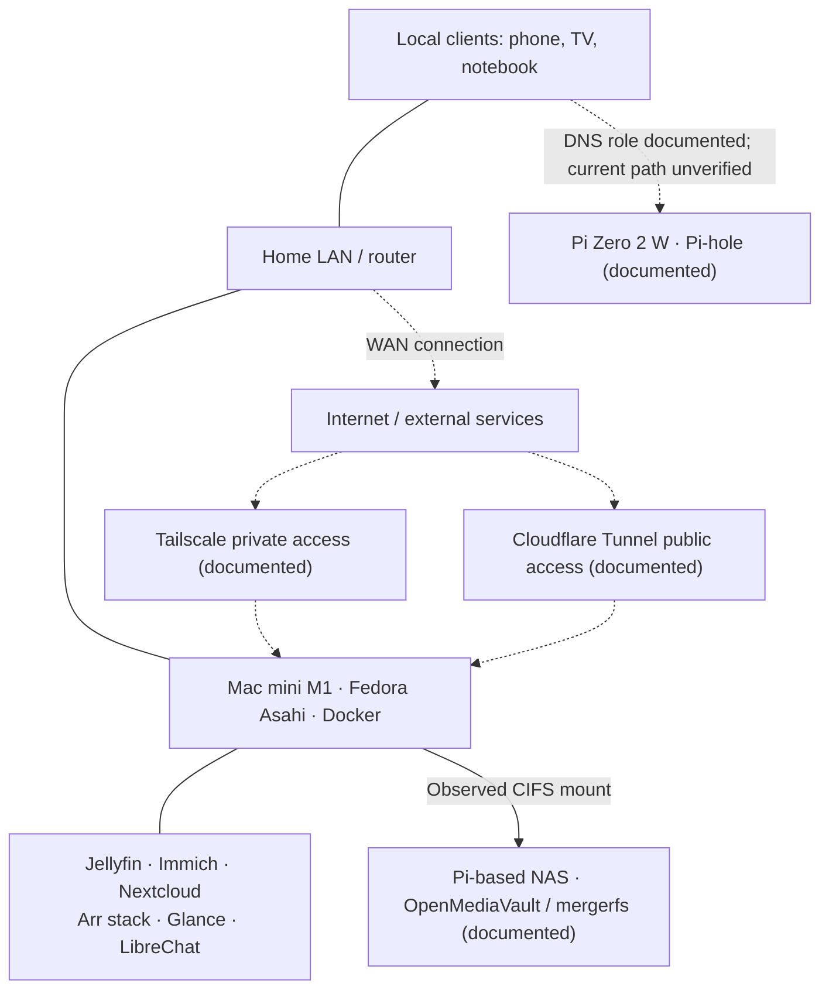

# Architecture

Baseline: October 27, 2026 Mac mini inventory, supplemented by explicitly identified older notes and November 2 owner reports. Source IDs refer to [the evidence register](evidence.md).



The SVG above is self-contained and can be viewed offline. Editable Mermaid source:



Solid lines summarize local relationships; dashed lines identify external or historically documented paths. Lines do not prove firewall rules, routing isolation, encryption, or successful application tests. NAS and DNS hardware details are historical documentation, not fresh node inspections.

Plain-text equivalent, readable without a diagram renderer:

```text
Phone / TV / notebook
          |
       Home LAN -------- Mac mini M1 / Docker
          |                    |-- Jellyfin, Immich, Nextcloud
          |                    |-- Arr, Glance, LibreChat
          |                    +-- CIFS --> Pi-based NAS
          |
          +-- Pi-hole on Pi Zero 2 W [documented DNS role]
          |
          +-- Internet [external access and services]
                 |-- Tailscale private access [documented]
                 +-- Cloudflare Tunnel [documented]
```

## Application and data boundaries

- **Compute:** The Mac mini hosts six Compose projects in S1. The list of containers establishes presence, not successful user workflows or complete dependency wiring.
- **Shared storage:** S1 observes a CIFS/SMB 3.0 mount at `/mnt/nas/data`. S3/S4 describe media containers receiving this storage as `/data`. Current per-container bind mounts were not captured in S1.
- **Photo storage:** S6 records a copy from an Immich library directory to a NAS destination. It does not establish that Immich subsequently switched to that destination. The diagram therefore does not label Immich as fully migrated.
- **Databases:** S1 lists PostgreSQL, MongoDB, and cache/search containers. Their persistent data locations and backup consistency are not established by the container list. Do not assume all application data resides on the NAS.
- **DNS:** S2/S3 describe Pi-hole on a separate device. S1's DNS section is empty. The current resolver path and local hostname behavior are unknown.

## Offline boundary

The design places compute and shared storage on the home network. The reported outage experience is Jellyfin use on phone, TV, and notebook (S0). This supports a useful local media workflow, but does not establish cold-start recovery, simultaneous playback, transcoding, fresh authentication, or the offline behavior of other services.

Remote access and integrations are separate dependencies. No outage result is claimed for Tailscale, Cloudflare Tunnel, VPN-backed downloads, remote metadata, subtitles, or AI providers. The mere presence of LibreChat does not establish a local model or offline inference.

## Tradeoffs visible in the evidence

Separating compute and storage lets the application host use a remote share, while introducing a storage/network dependency. The inventory shows an active automount and a recovery timer, but the script contents and failure behavior were not available. Splitting DNS onto another device adds a separately managed component whose current availability has not been checked. No high-availability or automatic failover guarantee is made.
